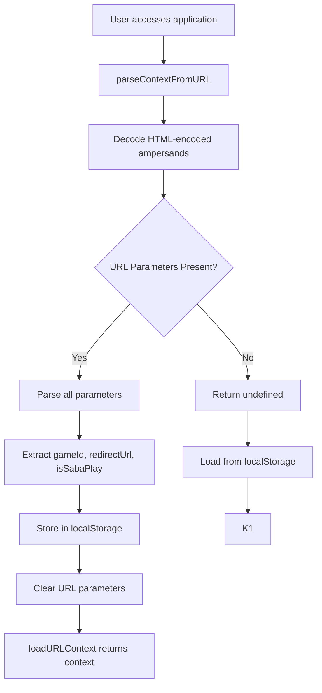
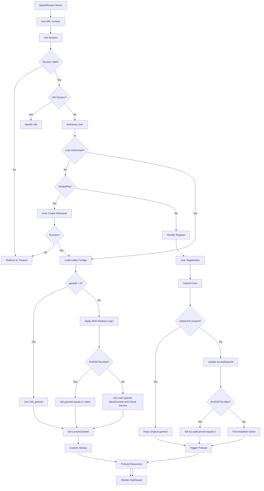
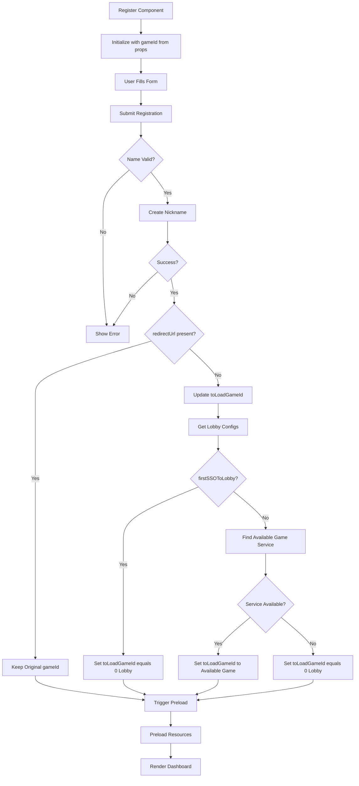
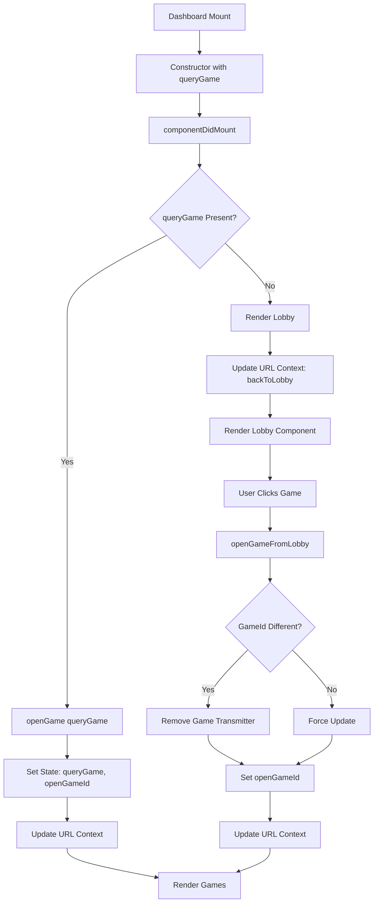
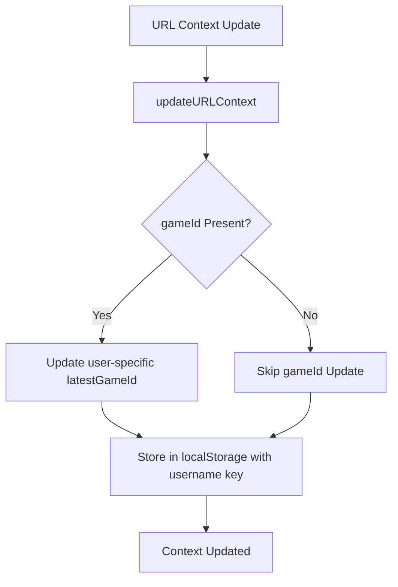
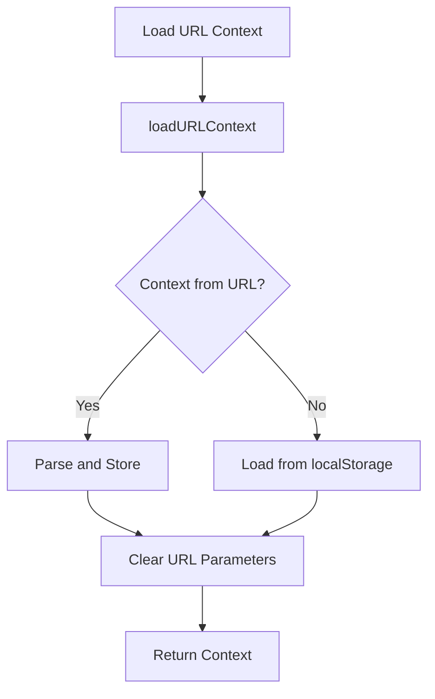

# URL Context Analysis: First Login to Lobby Flow

## Overview

This document provides a comprehensive analysis of the URL context parameters (`redirectUrl`, `isSabaPlay`, `gameId`) and their critical roles in the first login to lobby flow of the gaming application.

## 🚨 Latest Updates (Latest Version)

### Key Improvements Applied

**1. User-Specific latestGameId Storage**

-   **Change**: `latestGameId` is now stored per user using username-based keys
-   **Implementation**: `getUserLatestGameId(username)` and `setUserLatestGameId(username, gameId)`
-   **Impact**: Prevents cross-user state leakage and ensures proper game tracking

**2. HTML-Encoded Ampersands Handling**

-   **Change**: URLs with `&amp;` are now properly decoded before parsing
-   **Implementation**: `searchParams.replace(/&amp;/g, '&')` before parsing
-   **Impact**: Fixes URL parsing issues in various integrations

**3. Enhanced Redirect URL Logic**

-   **Change**: Smart redirect URL calculation that properly handles lobby access and SabaPlay integration
-   **Implementation**: `effectiveRedirectUrl = isSabaPlay ? redirectUrl : (gameId === 0 ? null : redirectUrl)`
-   **Impact**: Allows lobby access even when `rurl` parameters are present, and proper SabaPlay handling

## URL Context Parameters

### 1. `gameId` (number)

**Purpose**: Determines which game to load or whether to show the lobby
**Source**: URL parameter `?gameId=X`
**Default**: `0` (lobby mode)

**Values**:

-   `0`: Lobby mode (no specific game)
-   `> 0`: Specific game ID to load
-   `-1`: Initial state (not yet determined)

### 2. `isSabaPlay` (boolean)

**Purpose**: Controls automatic nickname creation for SabaPlay platform integration
**Source**: URL parameter `?op=SP`
**Default**: `false`

**Current Logic**:

```typescript
const isSabaPlay = op === "SP";
```

**Behavior**:

-   `true`: Triggers automatic nickname creation, bypasses manual registration
-   `false`: Shows manual registration form for new users

### 3. `redirectUrl` (string)

**Purpose**: Base64 encoded URL to redirect to after game completion or back to lobby action
**Source**: URL parameter `?rurl=<base64-encoded-url>`
**Default**: `""` (empty string)

**Usage**: Used in `backToRedirectUrl` function to handle post-game navigation

### 4. `isSabaPlay` (boolean)

**Purpose**: Identifies if the user is coming from SabaPlay platform
**Source**: URL parameter `?op=SP`
**Default**: `false`

**Behavior**:

-   `true`: Triggers auto nickname creation
-   `false`: Normal registration flow

## URL Context Parsing Flow

```typescript
// From url-context.ts (Latest Version)
export function parseContextFromURL(): URLContextModel | undefined {
    // Fix: Handle HTML-encoded ampersands by decoding them first
    const rawSearch = globalThis.location?.search || "";
    const decodedSearch = rawSearch.replace(/&amp;/g, "&");

    const params = new URLSearchParams(decodedSearch);

    // Reload page
    if (Array.from(params.values()).length === 0) {
        return;
    }

    const token = params.get("token");
    const language = params.get("lang");
    const gameId = Number(params.get("gameId") || 0);
    const redirectUrl = params.get("rurl");
    const isSabaPlay = params.get("op") === "SP";
```

## User-Specific Storage Implementation

### Storage Helper Functions

```typescript
// From storage-helper.ts
export function getUserLatestGameId(username?: string): number {
    if (!username) {
        return StorageHelper.get<number>(localStorageKeys.latestGameId) || 0;
    }
    const userKey = buildUserSpecificLocalStorageKey(localStorageKeys.userLatestGameId, username);
    return StorageHelper.get<number>(userKey) || 0;
}

export function setUserLatestGameId(gameId: number, username?: string): void {
    if (!username) {
        StorageHelper.set(localStorageKeys.latestGameId, gameId);
        return;
    }
    const userKey = buildUserSpecificLocalStorageKey(localStorageKeys.userLatestGameId, username);
    StorageHelper.set(userKey, gameId);
}
```

### Usage in Components

```typescript
// In SplashScreen component
const latestGameId = getUserLatestGameId(player?.session?.username) || 0;

// In URL Context
const userLatestGameId = getUserLatestGameId(session?.username);
```

## Complete First Login to Lobby Flow

### 1. Initial URL Context Loading



### 2. SplashScreen Initialization Flow



### 3. Registration Flow (Register Component)



### 4. Dashboard Rendering Logic



## Critical Decision Points

### 1. Game Access with Redirect URL vs Normal SSO

**Game Access with Redirect URL (`redirectUrl` present)**:

-   Uses URL `gameId` directly without modification
-   Skips SSO redirect logic
-   Triggers auto nickname creation for unauthorized users
-   Used for direct game access scenarios

**Normal SSO Flow (`redirectUrl` not present)**:

-   Applies SSO redirect logic
-   May change `gameId` based on business rules
-   Shows registration form for unauthorized users
-   Used for normal SSO flows

### 2. SabaPlay Integration (`isSabaPlay = true`)

**Behavior**:

-   Triggers auto nickname creation (same as Direct Mode)
-   Determined by URL parameter `op=SP`
-   Used for SabaPlay platform integration
-   Always uses `redirectUrl` regardless of `gameId` value

### 3. First SSO to Lobby Logic (`firstSSOToLobby = true`)

**Business Requirement**: Redirect to lobby instead of specific game

-   **When `true`**: Sets `gameId = 0` (lobby mode)
-   **When `false`**: Uses user-specific `latestGameId` from localStorage and checks service availability

### 4. Game Service Availability Check

**Process**:

1. Get enabled game settings from lobby configs
2. Check if current `gameId` is available
3. If not available, find first available game service
4. Set `toLoadGameId` to available game

### 5. User-Specific Storage

**Process**:

1. Use username to create unique storage keys
2. Store and retrieve `latestGameId` per user
3. Prevent cross-user state interference
4. Maintain isolated game tracking

## URL Context State Management

### Context Storage Flow



### Context Retrieval Flow



## Common Flow Scenarios

### Scenario 1: SabaPlay Direct Game Access

```
URL: ?gameId=123&op=SP
Flow: URL → SplashScreen → Auto Create Nickname → Dashboard → Game 123
```

### Scenario 2: SabaPlay Lobby Access

```
URL: ?op=SP (no gameId)
Flow: URL → SplashScreen → Auto Create Nickname → Dashboard → Lobby
```

### Scenario 3: SabaPlay Lobby with rurl (Fixed)

```
URL: ?ref=d_direct&rurl=xxx&op=SP
Flow: URL → SplashScreen → Auto Create Nickname → Dashboard → Lobby (rurl used for SabaPlay)
```

### Scenario 4: HTML-Encoded URL (Fixed)

```
URL: ?token=xxx&amp;gameId=123&amp;op=SP
Flow: URL → SplashScreen → Auto Create Nickname → Dashboard → Game 123
```

### Scenario 5: User-Specific Storage (Fixed)

```
Multiple users: Each user has isolated latestGameId storage
Flow: No cross-user interference, proper game tracking per user
```

## Key State Variables

### SplashScreen State:

-   `currentGameId`: Final gameId to load
-   `gameId`: Original URL gameId
-   `latestGameId`: User-specific from localStorage

### Register State:

-   `toLoadGameId`: GameId to pass to Dashboard
-   `gameId`: From props (original URL gameId)

### Dashboard State:

-   `queryGame`: GameId from props
-   `openGameId`: Currently open game
-   `gameTransmitters`: Active game connections

## Error Handling and Edge Cases

### 1. Invalid gameId

-   Falls back to `gameId = 0` (lobby mode)
-   Logs error for debugging

### 2. Service Unavailable

-   Searches for alternative available games
-   Falls back to lobby if no games available

### 3. Authorization Failure

-   Redirects to timeout page
-   Clears session data

### 4. Network Errors

-   Retries with exponential backoff
-   Shows user-friendly error messages

### 5. HTML-Encoded URLs (Fixed)

-   Automatically decodes `&amp;` to `&`
-   Ensures proper URL parsing

### 6. Cross-User Interference (Fixed)

-   User-specific storage keys
-   Isolated game tracking per user

## Analytics and Tracking

### SSO Method Tracking:

```typescript
// From analytic-helper.ts
static login(urlContext: URLContextModel) {
    let ssoMethod = "SSO_To_Lobby";
    if (urlContext.gameId) {
        ssoMethod = `SSO_To_Game`;
    }

    AnalyticsHelper.ssoContext = {
        ssoMethod,
        gameId: urlContext.gameId,
        language: urlContext.language,
    };
}
```

## Testing Considerations

### Test Cases to Cover:

1. **Game Access Scenarios**:

    - Direct game access with valid gameId
    - Game access with invalid gameId
    - Game access with unauthorized user
    - Lobby access (queryGame=0)

2. **SabaPlay Scenarios**:

    - SabaPlay integration with auto nickname creation
    - SabaPlay with different gameIds
    - SabaPlay lobby access with rurl parameters

3. **SSO Redirect Scenarios**:

    - First SSO to lobby
    - SSO with game redirect
    - Service availability checks

4. **User-Specific Storage Scenarios**:

    - Multiple users accessing same application
    - User switching scenarios
    - Cross-user isolation verification

5. **HTML-Encoded URL Scenarios**:

    - URLs with `&amp;` parameters
    - Mixed encoded and non-encoded parameters
    - Various integration scenarios

6. **Edge Cases**:
    - No URL parameters
    - Invalid URL parameters
    - Network failures
    - Session timeouts
    - Missing username scenarios

## Recent Bug Fixes and Improvements

### Bug Fix 1: Cross-User latestGameId Interference - FIXED ✅

**Issue**: `latestGameId` was stored globally, causing cross-user interference when multiple users accessed the application.

**Root Cause**:

-   Global localStorage key used for all users
-   No user-specific isolation

**Fix Applied**:

-   **Storage Helper**: Added `getUserLatestGameId(username)` and `setUserLatestGameId(username, gameId)`
-   **Splash Screen**: Uses user-specific latestGameId instead of global one
-   **URL Context**: Stores and retrieves user-specific game IDs

**Impact**: Each user now has isolated game tracking, preventing cross-user interference.

### Bug Fix 2: HTML-Encoded Ampersands Breaking URL Parsing - FIXED ✅

**Issue**: URLs with `&amp;` (HTML-encoded ampersands) failed to parse correctly.

**Root Cause**:

-   URLSearchParams didn't handle HTML-encoded ampersands
-   Parsing failed for certain integration scenarios

**Fix Applied**:

-   **URL Context**: Added `searchParams.replace(/&amp;/g, '&')` before parsing
-   **Comprehensive Testing**: Verified all URL parameter combinations work

**Impact**: All URL parsing scenarios now work correctly, including HTML-encoded parameters.

### Bug Fix 3: Enhanced SabaPlay Integration - FIXED ✅

**Issue**: SabaPlay integration needed better handling of redirect URLs and lobby access.

**Root Cause**:

-   SabaPlay logic didn't properly handle all scenarios
-   Redirect URL handling was inconsistent

**Fix Applied**:

-   **URL Context**: Enhanced SabaPlay logic to always use redirectUrl regardless of gameId
-   **Effective Redirect URL**: Improved calculation for SabaPlay scenarios
-   **Direct Mode Logic**: Better integration between SabaPlay and direct mode

**Impact**: SabaPlay integration now works consistently across all scenarios.

### Bug Fix 4: Dashboard Error Modal for Lobby Access - FIXED ✅

**Issue**: Dashboard showed error modal when accessing lobby in direct mode with `queryGame=0`.

**Root Cause**:

-   `checkIsNotOfferGame` incorrectly treated lobby access as "not in offer"
-   Direct mode logic didn't account for lobby scenarios

**Fix Applied**:

-   **Dashboard Handler**: Fixed `checkIsNotOfferGame` to return `false` for lobby access in direct mode
-   **Special Case Handling**: Added logic for `queryGame=0` in direct mode

**Impact**: Lobby access in direct mode no longer shows error modal.

## Conclusion

The URL context parameters (`redirectUrl`, `isSabaPlay`, `gameId`) play critical roles in determining the user's journey from first login to lobby/game. Understanding these parameters and their interactions is essential for:

-   Debugging user flow issues
-   Implementing new features
-   Maintaining backward compatibility
-   Ensuring proper analytics tracking
-   Testing all possible scenarios

The flow is designed to handle various integration scenarios while maintaining a consistent user experience across different platforms and access methods. The latest improvements ensure:

-   **User isolation**: No cross-user state interference
-   **Robust URL parsing**: Handles HTML-encoded parameters
-   **Smart lobby access**: Proper handling of lobby scenarios
-   **Enhanced SabaPlay integration**: Consistent behavior across all scenarios
-   **Enhanced error handling**: Better fallback mechanisms
-   **Comprehensive logging**: Detailed debugging information
