# URL Context Flow Diagrams

## 1. Complete First Login to Lobby Flow

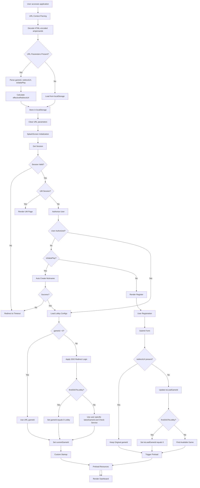

## 2. URL Context Parameter Decision Tree

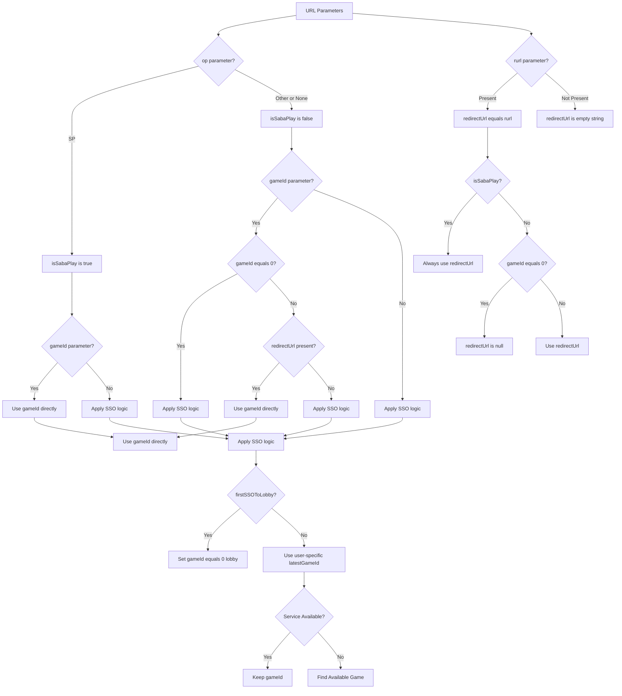

## 3. Registration Flow Decision Matrix

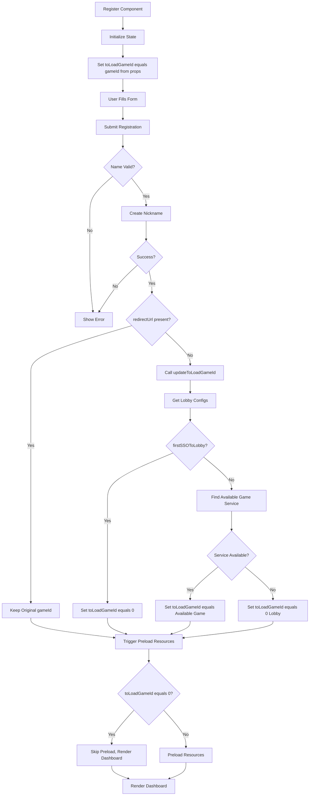

## 4. Dashboard Rendering Logic Flow

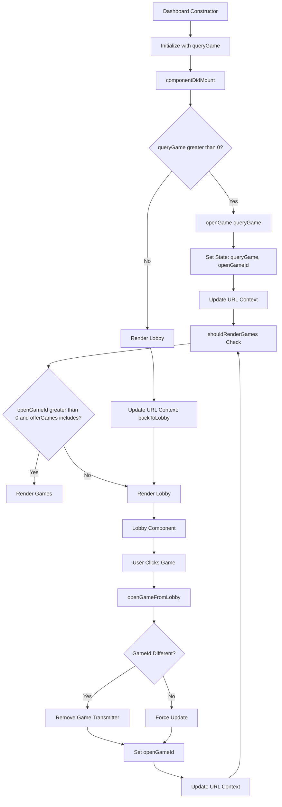

## 5. URL Context State Management Flow

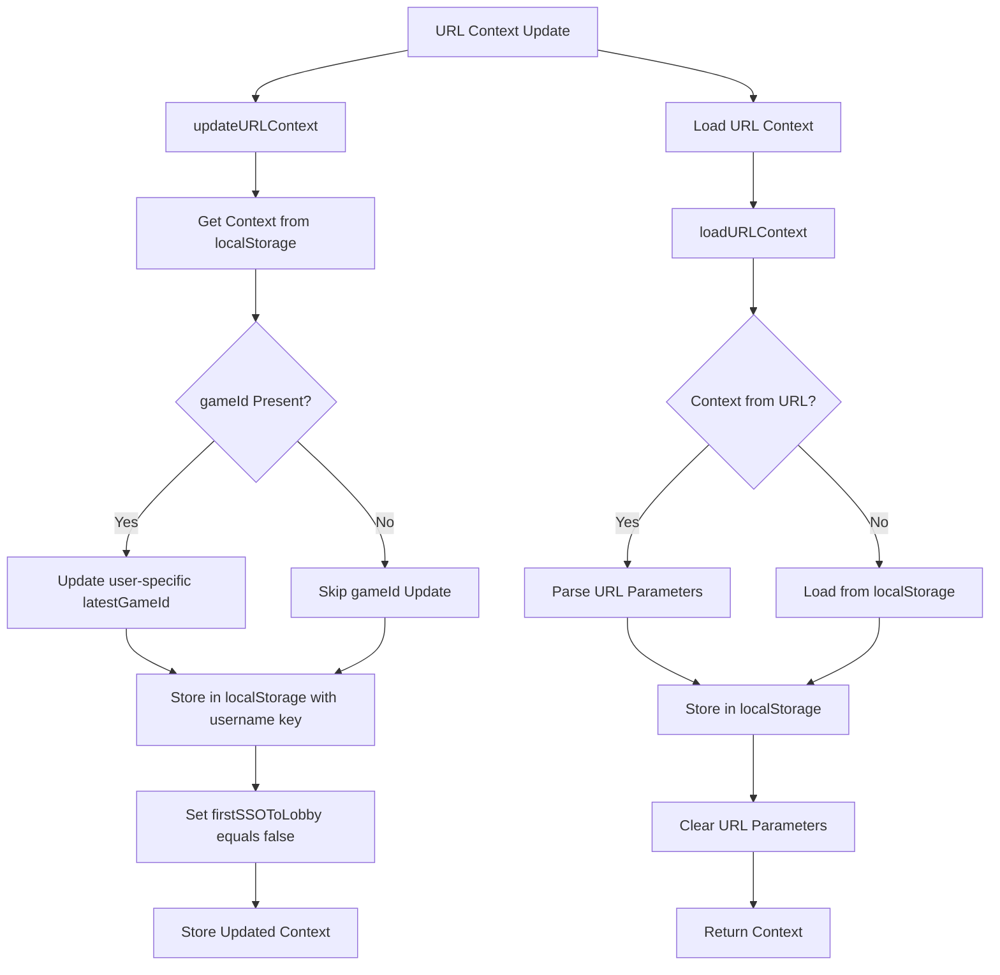

## 6. Service Availability Check Flow

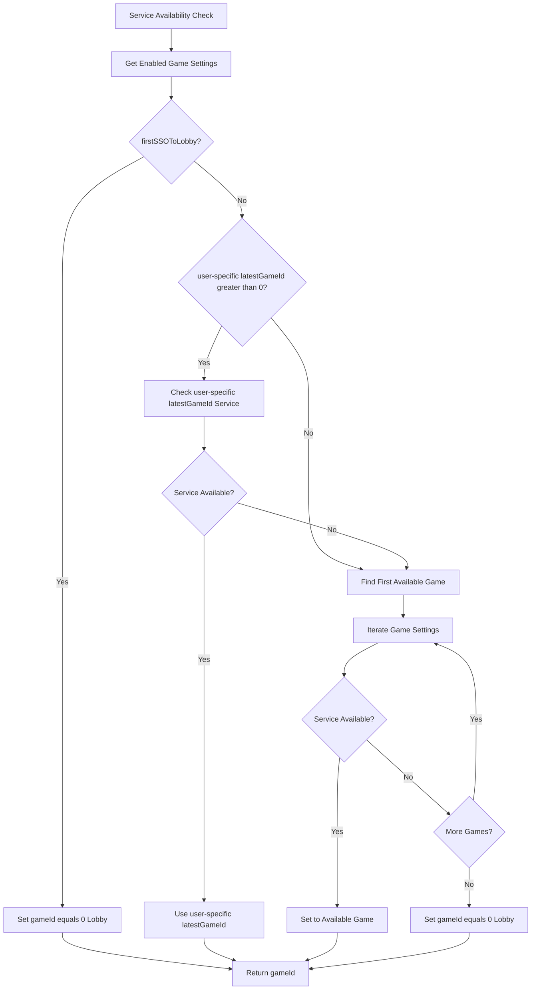

## 7. Auto Nickname Creation Flow

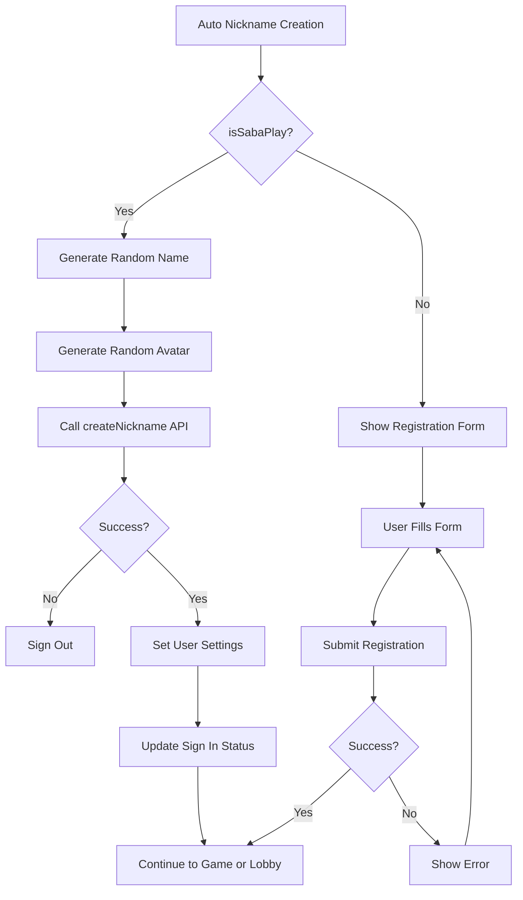

## 8. User-Specific Storage Flow

```mermaid
flowchart TD
    A8[User-Specific Storage] --> B8{Username Available?}
    B8 -->|Yes| C8[Create User-Specific Key]
    B8 -->|No| D8[Use Global Key]

    C8 --> E8[Store/Retrieve with Username Prefix]
    D8 --> F8[Store/Retrieve with Global Key]

    E8 --> G8[Isolated User Data]
    F8 --> H8[Global Data]

    G8 --> I8[No Cross-User Interference]
    H8 --> J8[Fallback for Anonymous Users]

    A8 --> K8[Update latestGameId]
    K8 --> L8{Username Present?}
    L8 -->|Yes| M8[Set User-Specific latestGameId]
    L8 -->|No| N8[Set Global latestGameId]

    M8 --> O8[User-Specific Storage Key]
    N8 --> P8[Global Storage Key]

    O8 --> Q8[Isolated Game Tracking]
    P8 --> R8[Global Game Tracking]
```

## 9. HTML-Encoded URL Handling Flow

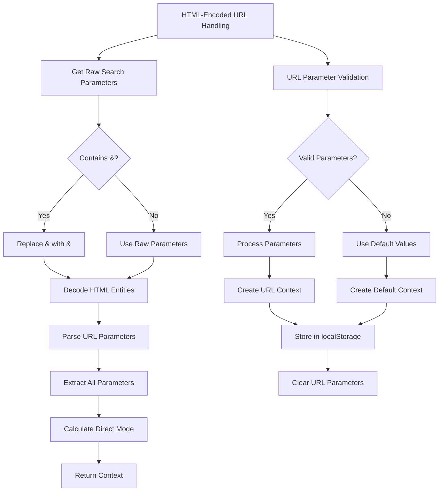

## 10. Enhanced Direct Mode Logic Flow

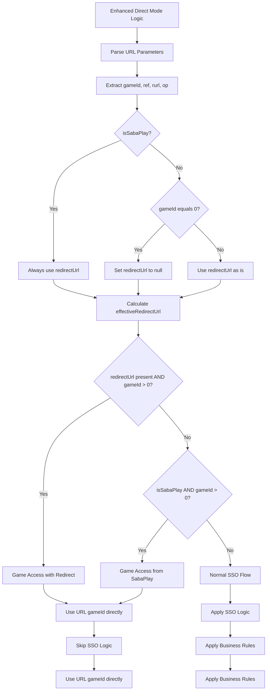

## 11. Recent Bug Fixes and Flow Improvements

### Bug Fix: Registration Flow Getting Stuck

**Issue**: New users with URLs like `?token=xxx&lang=vi-VN&appType=1&op=GN&cg=Credit_VN` (missing gameId, non-direct mode, non-SabaPlay) would get stuck after registration completion.

**Root Cause**:

1. `PreloadResourceRegister.handleAuthorizedAccess` was not calling `updateStatePreloadResource()` when lobby configs were successfully loaded
2. `Register.updateToLoadGameId` had no fallback when no enabled games were available

**Fix Applied**:

#### 1. PreloadResourceRegister Fix

```typescript
const handleAuthorizedAccess = async () => {
    try {
        const lobby = await getLobbyConfigs(session);
        if (!lobby || Object.keys(lobby.lobbyConfigs).length === 0) {
            updateStatePreloadResource();
        } else {
            if (lobby?.lobbyConfigs) {
                updateLobbyConfigs(lobby?.lobbyConfigs);
                getAndHandleBannerOffer(authorizeResponse, lobby?.lobbyConfigs, setBannerId);
                getAndHandleGameOfferIds(authorizeResponse, lobby?.lobbyConfigs, setGameOfferIds);
                // Fix: Call updateStatePreloadResource when lobby configs are successfully loaded
                updateStatePreloadResource();
            }
        }
    } catch (error) {
        console.error(error);
        // Fix: Call updateStatePreloadResource even on error to prevent getting stuck
        updateStatePreloadResource();
    }
};
```

#### 2. Register updateToLoadGameId Fix

```typescript
updateToLoadGameId = async (authorizeResponse: AuthorizeResponse) => {
    const lobby = await getLobbyConfigs(session);
    const enabledRenderGameSettings = getEnabledRenderGameSettings(lobby?.lobbyConfigs, authorizeResponse);

    if (firstSSOToLobby && enabledRenderGameSettings.length > 0) {
        this.setState({ toLoadGameId: 0 });
    } else if (enabledRenderGameSettings.length > 0) {
        for (const gameSetting of enabledRenderGameSettings) {
            const isServiceAvailable = await getServiceStatusIsAvailable(gameSetting);
            if (isServiceAvailable) {
                this.setState({ toLoadGameId: gameSetting.id });
                break;
            }
        }
    } else {
        // Fix: Handle case when no enabled games are available - default to lobby
        this.setState({ toLoadGameId: 0 });
    }
};
```

**Impact on Flow Diagrams**:

-   All registration flows now have a guaranteed path to completion
-   Error handling prevents flows from getting stuck
-   Lobby fallback ensures users always have a destination
-   Network errors are handled gracefully

**Updated Flow Behavior**:

-   **Before Fix**: Flows could get stuck when lobby configs loaded successfully
-   **After Fix**: All flows complete successfully with proper error handling

## 12. Back to Lobby Flow

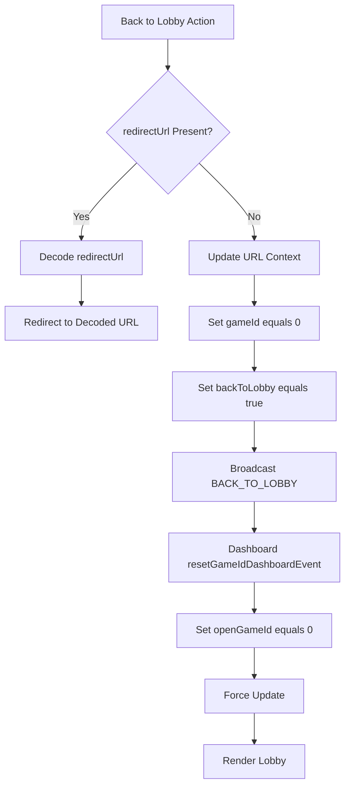

## 13. Analytics Tracking Flow

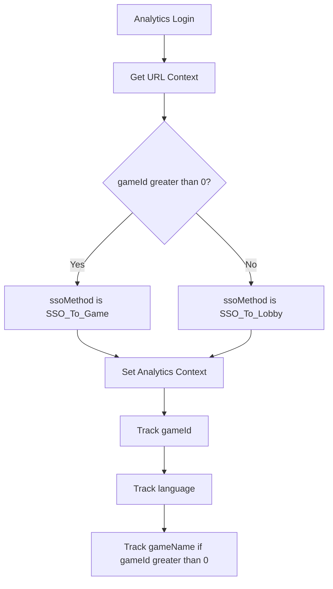

## 14. Error Handling Flow

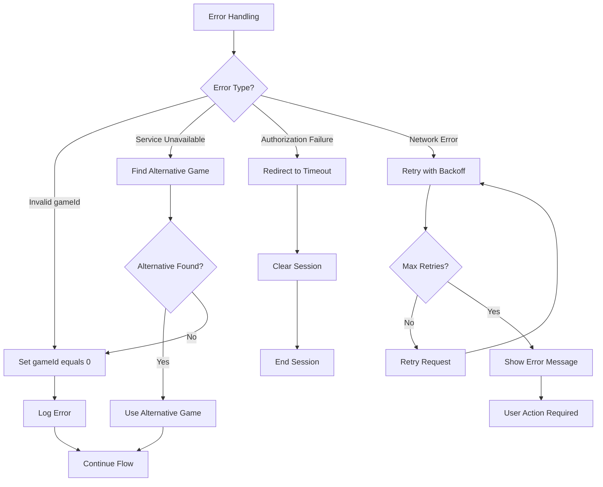

These diagrams provide a comprehensive visual representation of how the URL context parameters interact throughout the first login to lobby flow, helping developers understand the complex decision-making logic and state management involved in the application. The latest improvements ensure:

-   **User isolation**: No cross-user state interference
-   **Robust URL parsing**: Handles HTML-encoded parameters
-   **Smart lobby access**: Proper handling of lobby scenarios
-   **Enhanced SabaPlay integration**: Consistent behavior across all scenarios
-   **Enhanced error handling**: Better fallback mechanisms
-   **Comprehensive logging**: Detailed debugging information
