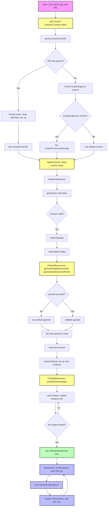

# URL Context and SplashScreen Flow

This document details the flow of URL context parsing and the SplashScreen initialization in the client application, based on the provided debug logs. It includes a step-by-step breakdown and a flowchart diagram for clarity.

---

## Overview

When a user opens the application, the system determines the user's context (such as authentication token, language, and game selection) from the URL or local storage. This context is then used to initialize the SplashScreen, preload resources, and finally render the main dashboard and game components.

---

## Step-by-Step Flow

### 1. App Launch & URL Context Loading

-   **User opens the app** (possibly with query params in the URL).
-   `URLContext.loadURLContext` is called.
-   `parseContextFromURL` attempts to extract parameters like `token`, `lang`, `appType`, `op`, and `cg` from the URL.
-   If parameters are found, they are decoded and set as `contextFromURL`.
-   If not, the system checks localStorage for a previously saved context (`contextFromLocalStorage`).
-   If neither is available, a default context is used.

### 2. SplashScreen Initialization

-   The SplashScreen component receives the initial context (from URL, localStorage, or default).
-   It starts the initialization process:
    -   Calls `getSession` with the token to validate the session.
    -   Loads the selected language.
    -   Loads lobby/game configurations.
    -   Preloads resources (banners, game offer IDs, images, etc.).

### 3. Game Selection & Validation

-   If no `gameId` is provided, a default game is selected.
-   The selected or default game is validated against the enabled games list.
-   The final `gameId` to load is set.

### 4. Session Authorization & User Setup

-   The session is authorized.
-   User information is set up (analytics, player info, etc.).

### 5. Resource Preloading

-   The app preloads images and other resources required for the selected game.
-   A progress bar is updated as resources are loaded.
-   Once all resources are loaded, the dashboard is rendered.

### 6. Dashboard & Game Rendering

-   The dashboard displays user info, available games, and other UI components.
-   The selected game component is rendered and ready for user interaction.
-   User actions (such as switching games) update the URL context and user info as needed.

---

## Flowchart Diagram

---

## Key Log Events (Reference)

-   `[URLContext] loadURLContext called` — Entry point for context loading.
-   `[URLContext] parseContextFromURL called` — Attempts to parse URL params.
-   `[SplashScreen] SplashScreen component rendering` — SplashScreen starts with initial context.
-   `[SplashScreen] handleInitialization started` — Initialization logic begins.
-   `[PreloadResources] ...` — Resource preloading and progress updates.
-   `[Dashboard] ...` — Dashboard and game rendering.

---

## Notes

-   The flow ensures that user context is always determined before rendering the main UI.
-   Resource preloading is optimized for user experience, showing a progress bar and only rendering the dashboard when ready.
-   The system gracefully falls back to localStorage or defaults if URL parameters are missing.

---

_Last updated: [auto-generated]_
