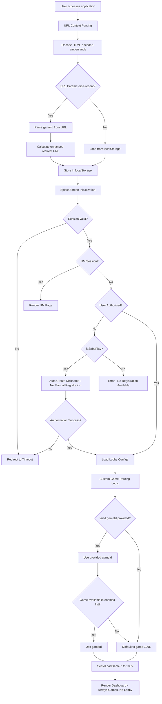

# Game ID Flow Workflow Analysis (Custom Version)

## Overview

This document outlines the complete workflow for how `gameId` is handled throughout the **custom version** of the application, from initial URL parsing to game selection and navigation. The custom version removes the Register component, lobby functionality, and implements custom game routing logic.

## 🚨 Latest Updates (Custom Version - Latest)

### Major Custom Version Changes Applied

**1. Register Component Removal**

-   **Change**: Completely removed the Register component page while keeping auto-create nickname flow
-   **Implementation**: Automatic nickname creation for SabaPlay users without manual intervention
-   **Impact**: Streamlined user experience, no manual registration required

**2. Lobby Functionality Removal**

-   **Change**: Removed entire lobby system and related components
-   **Implementation**: Direct game access only, no lobby interface
-   **Impact**: Simplified application flow, direct game access only

**3. Custom Game Routing Logic**

-   **Change**: Implemented custom version that directs users to specific game ID
-   **Implementation**: Default to game 1005 if no valid game ID provided or game not found
-   **Impact**: Predictable game routing with proper fallbacks

**4. User-Specific latestGameId Storage**

-   **Change**: `latestGameId` is now stored per user using username-based keys
-   **Implementation**: `getUserLatestGameId(username)` and `setUserLatestGameId(username, gameId)`
-   **Impact**: Prevents cross-user state leakage and ensures proper game tracking

**5. HTML-Encoded Ampersands Handling**

-   **Change**: URLs with `&amp;` are now properly decoded before parsing
-   **Implementation**: `searchParams.replace(/&amp;/g, '&')` before parsing
-   **Impact**: Fixes URL parsing issues in various integrations

## 1. Initial Application Load Flow (Custom Version)



## 2. Custom Game Routing Logic

### Priority Order (Custom Version):

1. **URL Parameter** (`?gameId=X`) - Highest priority
2. **Custom Validation** - Check if game is available in enabled games
3. **Default Fallback** - Always default to game 1005 for invalid scenarios
4. **No Lobby Mode** - Lobby functionality completely removed

### Custom Game Routing Implementation:

```typescript
// Custom version: Always direct to specific game, default to 1005 if no valid gameId
let toLoadGameId = gameId;

// If no gameId provided or gameId is 0, use default game 1005
if (!toLoadGameId || toLoadGameId === 0) {
    toLoadGameId = 1005;
```

### URL Context Parsing:

```javascript
// Enhanced URL parsing with HTML-encoded ampersands handling
let searchParams = globalThis.location?.search;

// Fix: Handle HTML-encoded ampersands
if (searchParams) {
    searchParams = searchParams.replace(/&amp;/g, "&");
}

const params = new URLSearchParams(searchParams);

// From URL parameters
gameId = Number(params.get("gameId") || 0);
ref = params.get("ref");
redirectUrl = params.get("rurl");
```

## 3. SplashScreen Game ID Logic (Custom Version)

### Auto Nickname Creation Flow:

```typescript
// Custom version: No manual registration, automatic nickname creation only
if (!authorizeInfo?.authorized && isSabaPlay) {
    // Auto create nickname without user intervention
    const autoCreateResult = await autoCreateNickname(session, isSabaPlay);

    if (autoCreateResult?.authorized) {
        // Continue with auto-created nickname
        authorizeInfo = autoCreateResult;
    } else {
        // Handle error case
        this.signOut();
        return;
    }
}
```

### Custom Game Routing Flow:

```typescript
// Custom version: Always direct to specific game, default to 1005 if no valid gameId
let toLoadGameId = gameId;

// If no gameId provided or gameId is 0, use default game 1005
if (!toLoadGameId || toLoadGameId === 0) {
    toLoadGameId = 1005;
}

// Validate if the gameId is available in the enabled games
const enabledRenderGameSettings = getEnabledRenderGameSettings(lobbyConfigs as any, authorizeInfo);
const isGameAvailable = enabledRenderGameSettings.some((game) => game.id === toLoadGameId);

// If game is not available, use default game 1005
if (!isGameAvailable) {
    toLoadGameId = 1005;
}

// Set the final game ID
this.setState({ toLoadGameId });
```

## 4. Dashboard Rendering (Custom Version)

### Always Render Games:

```typescript
// Custom version: Always render games, no lobby interface
renderDashBoard() {
    const isRenderGames = true; // Custom version: Always render games
    const renderOfferGameContainer = () => this.renderGames();

    return (
        <div className={styles["dashboard"]}>
            <Header />
            <SoundSettings />
            {isNoGameOffer ? <></> : renderOfferGameContainer()}
            <MusicPlayer />
        </div>
    );
}
```

### Game Component Rendering:

```typescript
// Custom version: Direct game rendering, no swiper functionality
renderGames() {
    const { userStakeLevel, openGameName } = this.state;
    const urlContext = loadURLContext();

    return (
        <Games
            setApiErrorMessage={this.notificationHandler.handleShowApiErrorMessage}
            userStakeLevel={userStakeLevel}
            updateUserStakeLevel={this.handleUpdateUserStakeLevel}
            openGameId={urlContext.gameId}
            openGameName={openGameName}

        />
    );
}
```

## 5. Game Component Logic (Custom Version)

### Simplified Game Rendering:

```typescript
// Custom version: No swiper functionality, direct game rendering
export const Games: React.FC<Props> = ({ setApiErrorMessage, userStakeLevel, updateUserStakeLevel, openGameId }) => {
    const getGameComponentById = (gameId: number) => {
        // Game component selection logic
        switch (gameId) {
            case GameIds.BacBall1:
            case GameIds.BacBall2:
                return <BacBall key={`game-${gameId}`} {...gameProps} />;
            // ... other games
            default:
                return null;
        }
    };

    return (
        <div className={`game-container ${styles["game-wrapper"]} ${styles["open-chips"]}`}>
            <SystemContextProvider>
                <div className={styles["game-list"]}>{getGameComponentById(openGameId)}</div>
            </SystemContextProvider>
        </div>
    );
};
```

## 6. Testing Scenarios (Custom Version)

### Scenario 1: SabaPlay Direct Game Access

-   **URL**: `?token=xxx&gameId=1003&op=SP`
-   **Expected**: Direct mode, game 1003, no error modal, no registration form

### Scenario 2: SabaPlay Invalid Game Access

-   **URL**: `?token=xxx&gameId=9999&op=SP`
-   **Expected**: Direct mode, fallback to game 1005, no error modal

### Scenario 3: SabaPlay No Game ID

-   **URL**: `?token=xxx&op=SP` (no gameId)
-   **Expected**: Direct mode, default to game 1005, no error modal

### Scenario 4: SabaPlay User Without Nickname

-   **URL**: `?token=xxx&gameId=1003&op=SP`
-   **Expected**: Automatic nickname creation, no manual registration form

### Scenario 5: One Game Per Session

-   **Action**: User attempts to switch games
-   **Expected**: No swiper functionality, single game only, no game switching

## 7. Key Changes Summary

### Removed Functionality:

1. **Register Component**: No manual registration form
2. **Lobby System**: No lobby interface or game selection
3. **Swiper Functionality**: No game switching within session
4. **SSO Redirect Logic**: Simplified to custom routing

### Added Functionality:

1. **Automatic Nickname Creation**: Seamless SabaPlay user onboarding
2. **Custom Game Routing**: Predictable fallback to game 1005
3. **Direct Game Access**: Simplified application flow
4. **One Game Per Session**: Consistent user experience

### Modified Logic:

1. **Game ID Validation**: Always validates against enabled games
2. **Fallback Mechanism**: Always defaults to game 1005
3. **Dashboard Rendering**: Always renders games, never lobby
4. **User Experience**: Streamlined, no manual intervention required

## 8. Impact Analysis

### Positive Impacts:

1. **Simplified User Experience**: No manual registration or lobby navigation
2. **Consistent Game Experience**: One game per session ensures focused gameplay
3. **Predictable Routing**: Always defaults to game 1005 for invalid scenarios
4. **Reduced Complexity**: Fewer components and less code to maintain

### Technical Benefits:

1. **Reduced Bundle Size**: Fewer components and dependencies
2. **Simplified State Management**: Less complex state logic
3. **Better Performance**: No swiper animations or lobby loading
4. **Easier Testing**: Fewer components to test

### Business Benefits:

1. **Streamlined Onboarding**: Automatic nickname creation
2. **Focused User Experience**: Single game per session
3. **Reduced Support**: Less complexity means fewer user issues
4. **Predictable User Flow**: Consistent experience across all users

This custom version provides a streamlined, single-game-per-session experience with predictable fallback behavior to game 1005, while maintaining all essential functionality through automatic processes.
